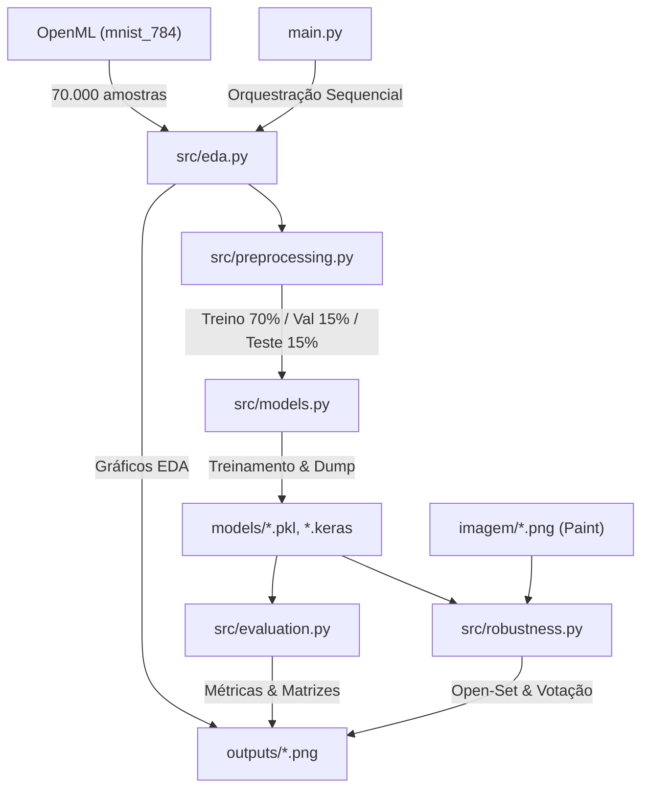

# Fase 0 — Auditoria do Projeto SCTEC MNIST

**Data da Auditoria:** 10 de Outubro de 2026  
**Responsável Técnico:** Engenharia de Software e Orientação Técnica SCTEC  
**Objetivo:** Inventariar detalhadamente o estado inicial do repositório, identificando o que já funciona, o que está incompleto ou com problemas e o que está faltando para atender a todas as exigências acadêmicas e técnicas do projeto.

---

## 1. Inventário Inicial do Repositório

### Estrutura de Arquivos Encontrada
- **Código Principal:**
  - `main.py`: Orquestrador das Fases 1 a 5 originais.
  - `src/__init__.py`: Inicializador do pacote.
  - `src/eda.py`: Carregamento do MNIST via OpenML e geração de gráficos de análise exploratória.
  - `src/preprocessing.py`: Normalização de escala $[0.0, 1.0]$ e divisão estratificada (70% treino, 15% validação, 15% teste).
  - `src/models.py`: Treinamento e persistência dos 5 modelos (Random Forest, KNN, SVM, MLP e CNN Keras).
  - `src/evaluation.py`: Cálculo de métricas preditivas (acurácia, precisão, recall, F1-score), tempos de inferência e matrizes de confusão.
  - `src/robustness.py`: Avaliação de classes ausentes (Open-Set Recognition com limiar de 50%) e pipeline OpenCV para processamento de 12 imagens reais desenhadas no Paint.
- **Modelos Treinados e Persistidos (`models/`):**
  - `random_forest.pkl` (~121 MB)
  - `knn.pkl` (~154 MB)
  - `svm.pkl` (~31 MB)
  - `mlp.pkl` (~1.3 MB)
  - `keras_cnn.keras` (~2.7 MB)
- **Artefatos Gráficos Existentes (`outputs/`):**
  - `distribuicao_classes.png`, `amostras_classes.png`, `digitos_medios.png`, `divisao_dados.png`, `comparativo_modelos.png`, `matrizes_confusao.png`, `robustez_classes_ausentes.png`, `teste_imagens_todos_modelos.png`, `tabela_resultados_paint.png`.
- **Amostras Manuscritas Externas (`imagem/`):**
  - 12 imagens PNG criadas no Microsoft Paint com variações de dígitos manuscritos.

---

## 2. Diagnóstico Técnico Sucinto

### Lista 1: Já Funciona ✅
1. **Pipeline de Modelagem e Treinamento:**
   - 5 modelos consolidados cobrindo diferentes paradigmas (baseados em árvores, instâncias, margens, conexões neurais densas e convoluções espaciais).
   - Reutilização inteligente dos artefatos persistidos em disco sem necessidade de re-treinamento a cada execução.
2. **Avaliação e Métricas:**
   - Cálculo rigoroso de Acurácia, Precisão, Recall e F1-score (macro e ponderado) em partição independente de teste (10.500 imagens).
3. **Visão Computacional com OpenCV:**
   - Pipeline robusto para imagens do Paint: detecção automática de cor de fundo (claro, escuro ou cinza), binarização adaptativa de Otsu, corte por contorno com aspect ratio preservado em caixa $20 \times 20$, e centralização por Centro de Massa em tela $28 \times 28$.
4. **Mecanismo de Rejeição sob Incerteza (Open-Set Recognition):**
   - Implementação de limiar de confiança $\ge 50\%$ para atribuir o status *"Não encontrado"* quando exposto a classes desconhecidas (ex: dígitos 3 e 8 omitidos do treino).

### Lista 2: Está Incompleto / Com Problemas ⚠️
1. **Probabilidades Não Padronizadas no SVM:**
   - O modelo `svm.pkl` foi instanciado com `SVC` padrão sem `probability=True`. O método `predict_proba` nativo não está disponível diretamente nele.
   - *Ação necessária:* Implementar calibração probabilística documentada (via softmax sobre `decision_function` ou Platt scaling) para garantir probabilidades de 0 a 9 somando 100% de forma comparável a todos os outros modelos.
2. **Divisão de Conjunto MNIST vs Padrão Canônico:**
   - O código original baixou 70.000 amostras via `fetch_openml('mnist_784')` e dividiu em 70/15/15 (49.000 treino, 10.500 validação e 10.500 teste).
   - *Ação necessária:* Documentar explicitamente a proveniência dos dados, licença do MNIST (Yann LeCun et al. / Creative Commons Attribution-Share Alike 3.0), e manter suporte a limites de amostras configuráveis para permitir testes rápidos em qualquer computador.
3. **Ausência da Documentação por Fases:**
   - A pasta `docs/etapas/` e o diretório `docs/graficos/` não existiam.

### Lista 3: Está Faltando ❌
1. **Banco de Dados SQLite & Suporte ao DBeaver:**
   - Base `.db` estruturada com a tabela `mnist_images` armazenando metadados e imagem em BLOB de 784 bytes uint8 com índices de busca.
   - Tabela sintética de demonstração `registros_demo` com os campos `id`, `rua`, `valor_a`, `valor_b`, `setor` e `data_criacao` (gerada deterministicamente para inspeção no DBeaver sem misturar com o MNIST).
   - Arquivo `.sql` de queries demonstrativas e guia de configuração no DBeaver.
2. **API REST FastAPI:**
   - Servidor FastAPI com rotas `/health`, `/models`, `/metrics`, `/predict` (vetor 784 pixels com probabilidades em %) e `/samples/{digit}`.
   - Validações completas via Pydantic e OpenAPI interativo em `/docs`.
3. **Aplicação Web Streamlit com Chatbot Integrado:**
   - Interface completa em português contendo: Visão Geral, Comparação de Modelos, Teste por Dígito (buscando imagem real do conjunto de teste), Teste por Desenho/Upload, Probabilidades Interativas, Matriz de Confusão, Explorador do SQLite e Chatbot local independente de chaves de API externas.
4. **Suíte de Testes Automatizados:**
   - Testes unitários para validação de pré-processamento, saída dos classificadores, integridade probabilística ($\sum P = 100\%$), integridade do SQLite e rotas da API.

---

## 3. Diagrama do Fluxo Inicial Auditado

---

## 4. Plano Priorizado de Execução e Correções

1. **Prioridade 1:** Criação da base SQLite (`data/mnist.db`), tabelas `mnist_images` e `registros_demo`, consultas DBeaver e módulo `src/database.py`.
2. **Prioridade 2:** Padronização da camada de inferência probabilística (`src/inference.py`) com probabilidades $0-9$ somando 100% para todos os 5 modelos.
3. **Prioridade 3:** Implementação da API FastAPI (`api/app.py`, `api/schemas.py`) com rotas documentadas e validação Pydantic.
4. **Prioridade 4:** Implementação da interface Streamlit (`app_streamlit.py`) com as 8 áreas exigidas e Chatbot local (`chatbot/bot.py`).
5. **Prioridade 5:** Criação da suíte de testes automatizados (`tests/`).
6. **Prioridade 6:** Documentação detalhada em `docs/etapas/` (fases 0 a 6), gráficos reais em `docs/graficos/` e atualização do `README.md`.
