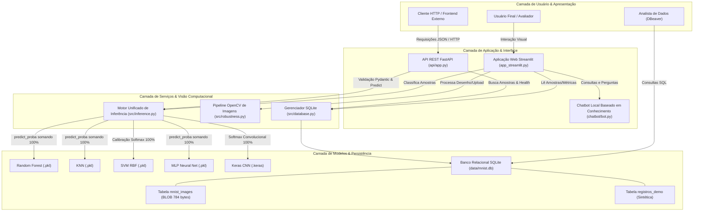

# Fase 1 — Escopo e Arquitetura do Sistema

**Projeto:** Classificação de Dígitos Manuscritos com Machine Learning  
**Evento:** SCTEC 2026 — Projeto Final  
**Documento:** `docs/etapas/01_escopo_arquitetura.md`  

---

## 1. Objetivo e Usuários-Alvo

O objetivo central deste projeto é fornecer uma plataforma integrada, didática, de alto desempenho e auditável para classificação e análise de imagens de dígitos manuscritos utilizando o conjunto de dados **MNIST**.

### Perfis de Usuário:
1. **Avaliadores Acadêmicos e Professores:** Necessitam inspecionar a metodologia científica, acurácia, latência, matrizes de confusão e robustez frente a classes ausentes e imagens externas.
2. **Engenheiros e Desenvolvedores de Software:** Necessitam consumir predições via API REST padronizada (FastAPI), inspecionar esquemas de persistência relacional (SQLite via DBeaver) e validar contratos de dados (Pydantic).
3. **Usuários Gerais e Estudantes:** Interagem com a aplicação visual (Streamlit), experimentando a classificação por busca de imagens de teste, desenho/upload em tempo real e tirando dúvidas com o assistente inteligente (Chatbot local).

---

## 2. Correção Conceitual Obrigatória: Digitar Rótulo vs. Inferir Imagem

Um princípio fundamental de Visão Computacional e Aprendizado de Máquina foi estabelecido:

> **Correção Conceitual:** Digitar apenas o caractere numérico "7" (um número escalar) **não é uma imagem** e não possui dimensão espacial ($28 \times 28$). Portanto, um classificador de imagens **não pode realizar inferência visual sobre um texto puro**.

### Comportamento Implementado na Aplicação:
- **Modo "Teste por Dígito":** Quando o usuário digita ou seleciona um dígito de $0$ a $9$, a aplicação **localiza uma imagem real de teste MNIST pertencente àquela classe verdadeira no banco de dados SQLite ou conjunto de dados reservado**. Essa imagem de $28 \times 28$ pixels é então exibida em tela e submetida à inferência de todos os 5 modelos. As predições e distribuições percentuais de probabilidade refletem o cálculo real sobre a imagem.
- **Modo "Desenho / Upload":** Quando o usuário desenha no canvas interativo ou envia um arquivo de imagem, a inferência é executada diretamente sobre os pixels fornecidos, após a normalização pelo pipeline OpenCV.
- **Transparência:** Em hipótese alguma o dígito digitado pelo usuário é exibido como se fosse a inferência do modelo ou inventado como probabilidade fictícia.

---

## 3. Hipótese Técnica sobre a Tabela de Demonstração `registros_demo` ("rua, A, B, setor")

Para atender à solicitação de campos administrativos (*"ID, rua, A, B, setor"*), foi adotada a seguinte diretriz de engenharia:
- Criou-se a tabela separada `registros_demo` no banco SQLite, com as colunas: `id`, `rua`, `valor_a`, `valor_b`, `setor` e `data_criacao`.
- Os registros são gerados de forma puramente sintética e determinística com semente fixa (`random_seed = 42`).
- **Isolamento Estrito:** Esses dados demonstram a facilidade de consulta relacional e junções no DBeaver, mas são explicitamente rotulados como dados sintéticos e **nunca são misturados ao conjunto MNIST** nem às métricas preditivas dos modelos de machine learning.

---

## 4. Diagrama de Arquitetura do Sistema (Mermaid)

---

## 5. Limites e Decisões Técnicas

1. **Eficiência e Escala:** O banco SQLite não carrega dezenas de milhares de registros na memória em cada renderização; a interface Streamlit utiliza paginação e limites (`LIMIT / OFFSET`).
2. **Independência de Serviços Externos:** O chatbot opera localmente sem consumo de chaves pagas (OpenAI/Anthropic) e sem envio de dados para fora do ambiente.
3. **Compartilhamento de Código:** A API FastAPI e a aplicação Streamlit compartilham os mesmos módulos (`src/inference.py`, `src/database.py` e `src/robustness.py`), garantindo consistência total nos resultados.
