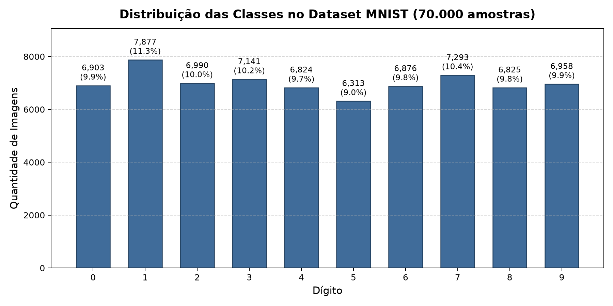
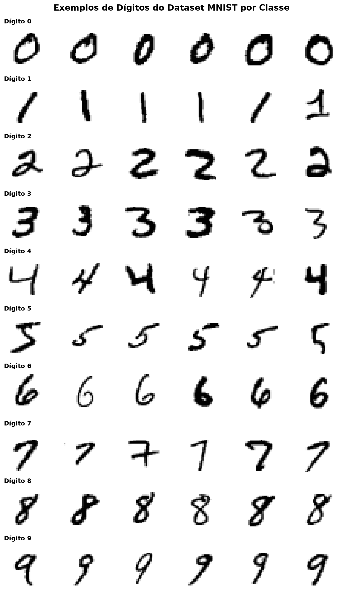

# Fase 2 — Dados, Integridade e Persistência SQLite

**Projeto:** Classificação de Dígitos Manuscritos com Machine Learning  
**Evento:** SCTEC 2026 — Projeto Final  
**Documento:** `docs/etapas/02_dados_banco.md`  

---

## 1. Origem, Rastreabilidade e Licença do MNIST

O conjunto de dados utilizado é o **MNIST** (*Modified National Institute of Standards and Technology database*), criado originalmente por Yann LeCun, Corinna Cortes e Christopher J.C. Burges a partir de amostras de funcionários do Censo dos EUA e alunos de ensino médio.

### Metadados e Rastreabilidade:
- **Origem dos Dados:** Carregado via scikit-learn através do repositório OpenML (`mnist_784`, ID: 554).
- **Dimensões das Imagens:** Tons de cinza, $28 \times 28$ pixels desdobrados em vetores unidimensionais de $784$ características.
- **Faixa de Intensidade Original:** Inteiros de $0$ (fundo preto) a $255$ (traço do dígito em branco).
- **Normalização Aplicada:** Mapeamento linear para $[0.0, 1.0]$ em ponto flutuante de 32 bits (`float32`).
- **Classes:** 10 classes correspondentes aos dígitos decimais $0$ a $9$.
- **Integridade:** Zero valores ausentes (`NaN`), nulos ou corrompidos em todas as $70.000$ amostras.
- **Licença e Atribuição:** O dataset MNIST é disponibilizado sob os termos da licença **Creative Commons Attribution-Share Alike 3.0 (CC BY-SA 3.0)**.
  > *Distinção importante:* Não confundir o MNIST ($28 \times 28$, 70.000 amostras) com o dataset de brinquedo `digits` do scikit-learn ($8 \times 8$, 1.797 amostras).

---

## 2. Análise Exploratória e Divisão dos Dados

### Gráfico Real de Distribuição de Classes
O dataset apresenta uma distribuição balanceada entre os 10 dígitos, com cada classe representando aproximadamente 10% do total (razão max/min de apenas 1.25), dispensando técnicas artificiais de sobreamostragem (SMOTE).



### Grade de Amostras Reais do MNIST
Abaixo estão representações visuais reais do conjunto, evidenciando as caligrafias e estilos de traçado:



---

## 3. Esquema Relacional do SQLite (`data/mnist.db`)

Para persistência de alta performance e consumo simplificado por ferramentas visuais de banco como o **DBeaver**, o esquema foi construído em SQLite:

### Tabela 1: `mnist_images`
Armazena as imagens de forma eficiente e compacta:
- `id` (INTEGER PRIMARY KEY AUTOINCREMENT)
- `digit` (INTEGER NOT NULL CHECK(digit >= 0 AND digit <= 9))
- `split` (TEXT NOT NULL CHECK(split IN ('train', 'val', 'test')))
- `width` (INTEGER NOT NULL DEFAULT 28)
- `height` (INTEGER NOT NULL DEFAULT 28)
- `image_blob` (BLOB NOT NULL — exatamente 784 bytes `uint8`)
- `source` (TEXT NOT NULL DEFAULT 'OpenML mnist_784')
- `created_at` (TIMESTAMP DEFAULT CURRENT_TIMESTAMP)
- **Índices de Otimização:** `idx_mnist_digit`, `idx_mnist_split`, `idx_mnist_digit_split`.

#### Justificativa da Coluna BLOB (784 bytes) vs 784 Colunas:
Em vez de criar 784 colunas na tabela (o que aumentaria a sobrecarga de metadados, reduziria o desempenho e violaria as melhores práticas de banco relacional), a imagem é armazenada em um único campo binário `image_blob` de 784 bytes (`uint8`).
A decodificação em Python é imediata:
```python
import numpy as np

# Decodificação direta em matriz 28x28
matriz_28x28 = np.frombuffer(row["image_blob"], dtype=np.uint8).reshape((28, 28))
# Escala normalizada [0.0, 1.0] para inferência
vetor_normalizado = (matriz_28x28 / 255.0).astype(np.float32)
```

---

## 4. Tabela de Demonstração Administrativa (`registros_demo`)

Para atender aos campos solicitados *"ID, rua, A, B, setor"*, foi criada uma tabela independente:
- `id` (INTEGER PRIMARY KEY AUTOINCREMENT)
- `rua` (TEXT)
- `valor_a` (REAL)
- `valor_b` (REAL)
- `setor` (TEXT)
- `observacao` (TEXT — *"Dado sintético gerado deterministicamente"*)
- `data_criacao` (TIMESTAMP DEFAULT CURRENT_TIMESTAMP)

> [!NOTE]
> Os dados desta tabela são gerados de forma determinística com semente `seed=42`, possuem rótulo explícito de dados sintéticos e **não interferem nem se misturam às imagens MNIST ou aos modelos preditivos**.

---

## 5. Instruções de Acesso no DBeaver

1. Abra o **DBeaver**.
2. Clique no ícone de tomada (**Nova Conexão**) e selecione **SQLite**.
3. Aponte o caminho do banco para o arquivo relativo `data/mnist.db` ou absoluto `C:\SCTEC_2026_Projeto_final\data\mnist.db`.
4. Teste a conexão e confirme.
5. Abra e execute o arquivo de consultas já preparado em [`data/queries_dbeaver.sql`](file:///c:/SCTEC_2026_Projeto_final/data/queries_dbeaver.sql).
