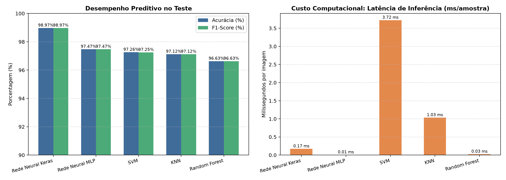
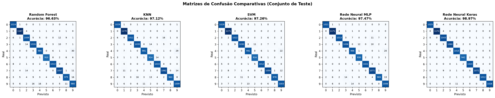

# Fase 3 — Modelagem, Avaliação e Saídas dos Modelos

**Projeto:** Classificação de Dígitos Manuscritos com Machine Learning  
**Evento:** SCTEC 2026 — Projeto Final  
**Documento:** `docs/etapas/03_modelos_avaliacao.md`  

---

## 1. Modelos Implementados e Hiperparâmetros

O projeto avalia cinco famílias algorítmicas de aprendizado de máquina supervisionado para classificação das 10 classes do MNIST:

1. **Random Forest (Scikit-Learn):**
   - Estrutura: Conjunto de $100$ árvores de decisão balanceadas.
   - Hiperparâmetros: `n_estimators=100`, `criterion='gini'`, `n_jobs=-1`.
   - Saída probabilística: `predict_proba` nativo calculando a fração de votos das árvores.
2. **K-Nearest Neighbors - KNN (Scikit-Learn):**
   - Estrutura: Classificação baseada em instâncias no espaço euclidiano $\mathbb{R}^{784}$.
   - Hiperparâmetros: $k=3$ vizinhos, `weights='distance'` (pesos inversamente proporcionais à distância euclidiana).
   - Saída probabilística: `predict_proba` nativo ponderado.
3. **Support Vector Machine - SVM (Scikit-Learn):**
   - Estrutura: Hiperplanos de margem máxima com Kernel de Base Radial (RBF).
   - Hiperparâmetros: $C=5.0$, `kernel='rbf'`, `gamma='scale'`.
   - Normalização heurística: Softmax sobre os escores da margem (`decision_function`). A saída soma 1, mas não é probabilidade calibrada nem diretamente comparável à confiança dos demais modelos.
4. **Rede Neural MLP - Multi-Layer Perceptron (Scikit-Learn):**
   - Arquitetura: 2 camadas ocultas densas $(128, 64)$ neurônios com ativação ReLU.
   - Otimizador: Adam com taxa de aprendizado inicial $10^{-3}$, `batch_size=128`, `early_stopping=True`.
   - Saída probabilística: Camada de saída com ativação Softmax via `predict_proba`.
5. **Rede Neural Convolucional - CNN (TensorFlow / Keras):**
   - Arquitetura:
     - Entrada $(28, 28, 1)$
     - `Conv2D(32, (3, 3), activation='relu')` + `MaxPooling2D((2, 2))`
     - `Conv2D(64, (3, 3), activation='relu')` + `MaxPooling2D((2, 2))`
     - `Flatten()` + `Dropout(0.25)`
     - `Dense(128, activation='relu')`
     - `Dense(10, activation='softmax')`
   - Otimizador: Adam, função de perda `sparse_categorical_crossentropy`.

---

## 2. Tabela Comparativa de Desempenho no Teste Oficial (10.500 imagens)

A tabela abaixo sintetiza os resultados reais obtidos no conjunto de teste independente:

| Posição | Modelo | Acurácia (%) | Precisão ponderada (%) | Recall ponderado (%) | F1-Score ponderado (%) | Tempo Treino (s) | Latência Média (ms/img) |
| :---: | :--- | :---: | :---: | :---: | :---: | :---: | :---: |
| 🥇 | **Rede Neural Keras (CNN)** | **98.97%** | **98.98%** | **98.97%** | **98.97%** | 94.25 s | 0.124 ms |
| 🥈 | **Rede Neural MLP** | **97.47%** | **97.47%** | **97.47%** | **97.47%** | 24.64 s | **0.004 ms** ⚡ |
| 🥉 | **SVM (Kernel RBF)** | **97.26%** | **97.26%** | **97.26%** | **97.25%** | 43.39 s | 4.255 ms |
| 4 | **KNN ($k=3$)** | **97.12%** | **97.15%** | **97.12%** | **97.12%** | **0.03 s** | 1.155 ms |
| 5 | **Random Forest** | **96.63%** | **96.63%** | **96.63%** | **96.63%** | 13.68 s | 0.031 ms |

---

## 3. Gráficos Comparativos Reais

### Comparativo Visual de Acurácia, F1-Score e Custo Computacional
O gráfico abaixo correlaciona o desempenho preditivo (barras verticais) com o tempo de inferência e treinamento em escala logarítmica:

### Matrizes de Confusão Individuais e Análise de Erros
A análise das matrizes de confusão revela que a grande maioria das amostras situa-se na diagonal principal (predições corretas). Os erros residuais concentram-se em pares de ambiguidade caligráfica natural, como $(4 \leftrightarrow 9)$, $(3 \leftrightarrow 5)$ e $(7 \leftrightarrow 2)$:

---

## 4. Interpretação das Saídas

1. **Normalização:** As saídas são normalizadas para somar aproximadamente 100% na exibição. No SVM, a softmax dos escores não equivale a uma probabilidade calibrada.
2. **Confiança vs. Acurácia:** Uma predição com 99% de probabilidade indica que a entrada está muito próxima da distribuição estatística aprendida pelo modelo, mas **não garante acurácia absoluta**, especialmente sob ruído ou fora de distribuição (OOD).
