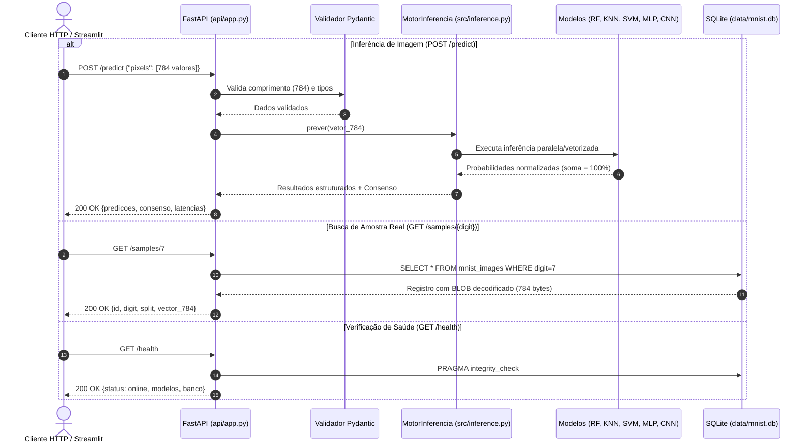

# Fase 4 — API REST FastAPI e Persistência SQLite

**Projeto:** Classificação de Dígitos Manuscritos com Machine Learning  
**Evento:** SCTEC 2026 — Projeto Final  
**Documento:** `docs/etapas/04_api_sqlite.md`  

---

## 1. Visão Geral da API

A camada de serviços expõe uma interface REST de baixa latência e alta confiabilidade implementada em **FastAPI**, com validação automática de contratos de dados via **Pydantic v2** e documentação interativa OpenAPI/Swagger disponível em `/docs`.

Os modelos de Machine Learning e Deep Learning são carregados em memória uma única vez na inicialização através do padrão Singleton (`MotorInferencia.get_instancia()`), eliminando custos de I/O a cada requisição.

---

## 2. Diagrama de Fluxo de Requisição (Mermaid)



---

## 3. Tabela de Endpoints da API

| Método | Endpoint | Descrição | Validação / Resposta |
| :---: | :--- | :--- | :--- |
| `GET` | `/health` | Estado do serviço, modelos ativos e integridade do SQLite | `HealthResponse` |
| `GET` | `/models` | Lista dos 5 modelos e seus respectivos metadados | `ModelsResponse` |
| `GET` | `/metrics` | Métricas completas calculadas no teste (10.500 amostras) | `MetricsResponse` |
| `POST` | `/predict` | Recebe vetor de 784 pixels e retorna predições dos 5 modelos | Validação estrita de 784 itens; saída somando 100% |
| `GET` | `/samples/{digit}` | Retorna metadados e vetor de uma amostra real do MNIST | `digit` restrito entre 0 e 9 |

---

## 4. Exemplos de Payload e Resposta

### Requisição: `POST /predict`
```json
{
  "pixels": [0.0, 0.0, 0.12, 0.85, 0.99, "... 784 valores ..."]
}
```

### Resposta: `200 OK`
```json
{
  "predicoes": {
    "Random Forest": {
      "classe_prevista": 7,
      "confianca_max_pct": 99.0,
      "probabilidades_pct": {
        "0": 0.0, "1": 0.0, "2": 0.0, "3": 0.0, "4": 0.0,
        "5": 0.0, "6": 0.0, "7": 99.0, "8": 0.0, "9": 1.0
      },
      "latencia_ms": 62.08,
      "tipo_saida": "predict_proba nativo"
    },
    "Rede Neural Keras": {
      "classe_prevista": 7,
      "confianca_max_pct": 99.99,
      "probabilidades_pct": {
        "0": 0.0, "1": 0.0, "2": 0.0, "3": 0.0, "4": 0.0,
        "5": 0.0, "6": 0.0, "7": 99.99, "8": 0.0, "9": 0.01
      },
      "latencia_ms": 12.35,
      "tipo_saida": "softmax convolucional"
    }
  },
  "consenso": {
    "digito_previsto": 7,
    "votos": "5/5",
    "concordancia_pct": 100.0
  },
  "aviso_metodologico": "Probabilidade e confiança refletem a certeza matemática do modelo sob os dados de treino, e não acurácia garantida."
}
```

---

## 5. Como Executar o Servidor FastAPI

Em um terminal dedicado:
```powershell
uvicorn api.app:app --host 127.0.0.1 --port 8000 --reload
```
Acesse a documentação interativa Swagger em: **`http://localhost:8000/docs`**.
