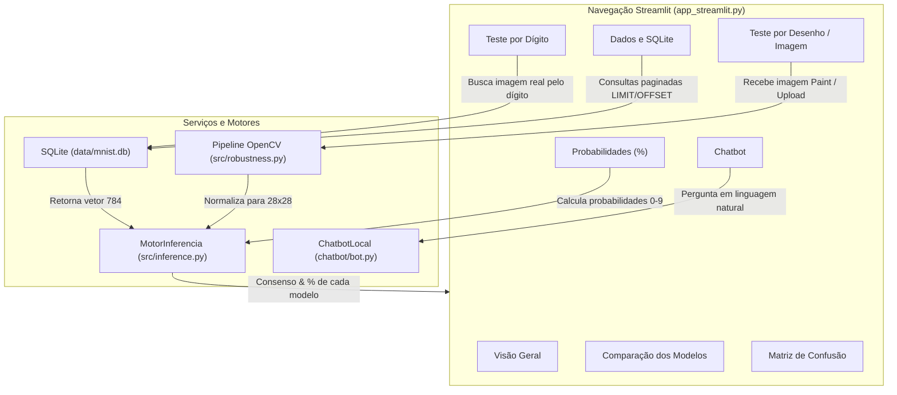

# Fase 5 — Interface Streamlit e Chatbot Local

**Projeto:** Classificação de Dígitos Manuscritos com Machine Learning  
**Evento:** SCTEC 2026 — Projeto Final  
**Documento:** `docs/etapas/05_streamlit_chatbot.md`  

---

## 1. Visão Geral da Interface Visual

A aplicação desenvolvida em **Streamlit** (`app_streamlit.py`) oferece uma experiência interativa, didática e em português do Brasil, estruturada em oito módulos funcionais:
1. **Visão Geral:** Metadados do projeto, métricas sumarizadas e integridade dos serviços.
2. **Comparação dos Modelos:** Gráficos de barra com valores numéricos exatos de acurácia, F1-macro e latência em milissegundos.
3. **Teste por Dígito:** Respeito à correção conceitual — busca de uma imagem real de teste no SQLite/dataset e inferência sobre ela.
4. **Teste por Desenho / Upload:** Pipeline OpenCV integrado com binarização adaptativa Otsu, enquadramento $20 \times 20$ e centralização por Centro de Massa na tela $28 \times 28$.
5. **Gráfico de Probabilidades (%):** Visualização interativa com barras das probabilidades de cada classe ($0$ a $9$) para os 5 modelos somando $100\%$.
6. **Matriz de Confusão & Classes:** Painel comparativo das matrizes de confusão e erros comuns de caligrafia.
7. **Dados e Banco SQLite:** Visualizador paginado das tabelas `mnist_images` (com decodificação do BLOB de 784 bytes) e `registros_demo` (dados sintéticos determinísticos).
8. **Chatbot do Projeto:** Assistente inteligente em linguagem natural com histórico conversacional.

---

## 2. Diagrama de Fluxo da Interface Streamlit (Mermaid)



---

## 3. Especificação do Chatbot Local e Fallback

### Principais Temas Suportados pelo Chatbot:
- **Objetivo do Projeto:** Propósito acadêmico do SCTEC 2026, escopo e tecnologias.
- **Dataset MNIST:** 70.000 imagens, resolução $28 \times 28$, balanceamento, licença CC BY-SA 3.0 e diferença para o dataset `digits` 8x8.
- **Modelos e Hiperparâmetros:** Random Forest, KNN, SVM, MLP e Keras CNN.
- **Resultados e Métricas:** Modelo campeão (Keras CNN com 98.97%), modelo mais rápido (MLP com 0.004 ms/img), latências e acurácias.
- **API FastAPI:** Endpoints `/health`, `/models`, `/metrics`, `/predict` e `/samples/{digit}`.
- **SQLite e DBeaver:** Arquivo `data/mnist.db`, tabelas `mnist_images` e `registros_demo`, consultas SQL.
- **Como Executar:** Comandos exatos para instalação e inicialização da API e Streamlit.
- **Correção Conceitual:** Explicação de que digitar um número busca imagem real no teste e não faz predição sobre caractere texto.

### Política de Fallback Honesto:
Se o usuário fizer uma pergunta que fuja do escopo ou que não possa ser verificada com rigor:
> O chatbot informa explicitamente que não possui a informação na base local e **não inventa dados**, direcionando o usuário para os documentos correspondentes em `docs/etapas/` e no `README.md`.

---

## 4. Como Iniciar a Interface Streamlit

Em um terminal dedicado:
```powershell
streamlit run app_streamlit.py
```
A aplicação abrirá automaticamente no navegador em: **`http://localhost:8501`**.
